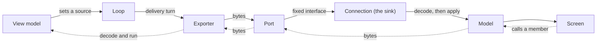

# Architecture

> **Status:** this page describes the design Oahu is being built to. The code arrives in small pull requests in the order set out in the [roadmap](roadmap.md), and until a part has landed, the types named here do not exist yet. Type names are the planned ones and may change before they ship. Sections will link to code as it lands.

## The central idea

Oahu keeps an app's view models in C# and writes each screen in the platform's own UI toolkit: SwiftUI on iOS, Jetpack Compose on Android. The two sides meet at a **contract**, and everything between them is generated.

A **contract** is a C# interface marked `[OahuContract]`. It declares what a screen can observe and what it can ask for, and nothing else:

```csharp
[OahuContract]
public interface ICounterViewModel
{
    IOahuState<int> Count { get; }
    void Increment();
}
```

A contract has **streams**, which carry values from the view model to the screen, and **members**, which the screen calls.

| Stream | Carries |
| --- | --- |
| `IOahuState<T>` | The current value. A new subscriber receives it at once. |
| `IOahuEditable<T>` | A current value that the screen can also change, such as the text of a field. |
| `IOahuEvents<T>` | Occurrences with no current value. Nothing is replayed. |
| `IOahuKeyedList<T>` | A list of rows with stable keys, sent as inserts, removes, moves, replacements and clears. |

A member is a **method**, returning `void` or `Task` and taking at most one value, or an **edit** to an editable. A `Task` method may also take a trailing `CancellationToken`. Members return nothing to the screen. A screen learns the result of a call the way it learns everything else: from the streams.

The values in a contract are immutable: booleans, the numbers `int`, `long` and `double`, strings, instants (`DateTimeOffset`), durations (`TimeSpan`), enums, records, unions of records, nullable values and lists of these. They compare by structure. [Contracts](contracts.md) lists them and the rules they follow.

The **view model** is an ordinary C# class that implements the contract. It knows nothing about its screen (it cannot tell whether one is attached, visible or covered) and it runs in a plain unit test with no device.

From the contract, Oahu generates both halves of the **seam**:

- In C#, an **exporter**: it subscribes to the view model's streams, encodes each value to bytes, and decodes and runs incoming member calls. A source generator writes it during compilation.
- In Swift or Kotlin, a **model**: an observable object with the contract's shape, which decodes the bytes and encodes member calls. A build step writes it into the app's native library.

The **screen** is hand-written native code that renders the model, in a file the app owns. On iOS it is a SwiftUI view. It has the whole toolkit available, runs in Xcode previews without .NET, and never touches bytes or the bridge.

The **host** is the Oahu package for one platform, such as `AdamE.Oahu.iOS`. It connects a view model to its native screen inside a .NET app for that platform.

Neither side is bound to the other by hand. Oahu binds one small, fixed interface per platform, once, and the same interface serves every contract.

## The path of one change



1. **Set.** A view model holds a **source** for each stream (`StateSource<T>`, `EditableSource<T>`, `EventSource<T>`, `KeyedListSource<T>`) and changes it. The source's current value changes at once. Setting a state or an editable to its current value publishes nothing. A state can also be **derived** from other sources, and then follows them.
2. **Deliver.** The **loop** (`OahuLoop`) notifies observers in a later **delivery turn**, never while the code that changed the value is still running. A delivery turn is one drain of the loop's queue. The loop posts it to the UI thread, so it normally runs in a later pass of that thread's run loop; the one exception is the drain in the member call described below. A turn runs until the queue is empty, so a change an observer makes during a turn is delivered in that same turn. Within a turn, sources deliver in the order they first changed since the last turn. What an observer receives depends on the stream:
   - A **state** or an **editable** delivers the value that is current when its delivery starts, and only if it differs from the last value that observer received. Several changes are one message. A change and its reversal are none.
   - A **keyed list** delivers every operation applied since the observer's last delivery, in order, as one batch. No operation is dropped.
   - **Events** are never merged. Each is delivered once.
3. **Encode.** The exporter writes the value in the **wire format** and hands the bytes to the **port**, the C# object the native side holds.
4. **Cross.** The port passes the stream's number, a pointer and a length to the screen's native **sink**. Each screen has one sink for all its streams: its **connection**, the native object that sits between the port and the model. The bytes are valid only during the call. Nothing is retained and nothing is marshalled per field.
5. **Apply.** The connection decodes the whole message first and applies it to the model only if it decoded completely, so the model is never left half-updated. A message that does not decode is a fault. The toolkit's own observation then redraws the screen.

A member call takes the same path in reverse: the model encodes the argument, the port hands the bytes to the exporter, and the exporter decodes them and calls the view model. Everything that call changes, up to the method's first `await`, reaches the screen before the outermost native call returns. After its own action has returned, a screen does not show the state from before it. This is the exception named in step 2: the exporter runs a delivery turn itself before the outermost native call returns, without waiting for the posted one. A call the screen makes while it is receiving a message is not outermost; what it changes is delivered later in the turn already running.

When a screen subscribes, the current value of each state and editable, and the current content of each keyed list, arrives before the subscribe call returns. A screen is never drawn without its data.

## Other operations

- **Edits.** A native model does not take an edited value for itself. It sends the edit and shows only what the view model publishes. The view model may accept the value, change it or refuse it, and must settle on one of these before its handler returns. If the value the view model settles on differs from the one it held, it is published, and reaches the screen before the outermost native call returns, as [the path of one change](#the-path-of-one-change) describes for any member call. An edit the screen makes while it is receiving a message is not outermost, and its result is delivered later in the turn already running. If it is the same, nothing is published and the screen goes on showing the value it already had. That is what a refusal looks like, and also a change that lands back on the current value, such as text cut down to a length it already had. The exporter checks the settlement as far as it can see it and accepts both cases; a mismatch is a fault.
- **Showing a screen.** A host shows a screen in one of two ways. As a **container**, it gets a platform view controller that holds the screen. As a **mount**, the view model is connected and registered under an ID, and the app's own native view hierarchy places it. A mounted screen is an ordinary view in that hierarchy, so native navigation, transitions and environment values work between Oahu screens as they do between any two views. Oahu has no navigation layer of its own.
- **Teardown.** Closing a screen ends the native side first, then the exporter, then whatever the host owns for the view model. A `Task` method still running sees its cancellation token cancelled. Failures during teardown are collected and reported together; one failure does not stop the rest. A screen closed from inside a native call is torn down in a later pass of the UI thread's run loop.
- **Failures and faults.** A method that throws, or whose `Task` fails or is cancelled, is a **failure**: it is reported to the host, and the app continues. The one exception is a cancellation that follows the screen's own close, which is expected and is not reported. A broken rule of the seam is a **fault**, such as a change made off the UI thread, bytes that do not decode, or an exception from an observer. Two rules hold in every runtime: a fault never unwinds across the bridge, and it is never swallowed, so the app ends. When the app ends depends on how the language stops. In C# and Kotlin a fault is an exception, which must not cross native frames: the core catches it, reports it once, and posts the end of the app to the UI thread through the host, for the next pass of the run loop. In Swift a fault stops the process where it is detected, without unwinding. A Swift fault can be detected inside a call from C#, as when a message does not decode, and then nothing on the C# side gets to report it.

## The wire format and the fixed interface

A message is the bytes of one value and nothing else. There is no header, tag or schema in it, because both sides are generated from the same contract.

- A `bool` is one byte. An `int` or a `long` is zigzag-encoded and then written as a variable-length integer; counts, lengths and indexes are variable-length integers without the zigzag step. A `double` is eight bytes, little-endian. No other numeric type can cross the seam. A string is a byte count followed by strict UTF-8.
- An instant is milliseconds since the Unix epoch in UTC, rounded down, encoded as a `long`. Its offset is not carried. A duration is a count of 100-nanosecond ticks, encoded as a `long`.
- A record is its fields in order. An enum is its index. A union is its case index followed by that case's fields. A nullable value is a presence byte followed by the value. A list is a count followed by its items. A method with no argument sends no bytes. Records and unions nest at most 64 deep, so every platform rejects the same too-deep values with an error instead of running out of stack.
- A keyed-list message is a batch of operations (insert, remove, move, replace, clear), applied all together or not at all. A list's current content is replayed as a clear followed by one insert for each row.

The **contract hash** is a 64-bit hash of the contract's canonical signature: every stream, member and type, by name and in order, prefixed with the format version. Both halves of the seam carry it. The core compares them when a host connects a screen and refuses a mismatch with an error that names the contract and both hashes, so the two halves cannot drift apart silently. The check is made once, in the core, so no host can leave it out. Compatibility is lockstep: the app's C# and native code are built together from one contract.

The **fixed interface** is the only thing Oahu binds between .NET and native code. On iOS it is four Objective-C protocols and one class:

| Protocol | Implemented by | Does |
| --- | --- | --- |
| Port | C# | Takes the screen's sink, subscribes and unsubscribes a stream, runs a member |
| Sink | Native, the connection | Receives each message, with the number of the stream it belongs to |
| Screen provider | Native, generated | Reports the contract hash it was generated for, and creates the screen for a port |
| Screen handle | Native | Holds the created screen and closes it |

The class is the native **mount registry**, which issues mount IDs and resolves them for the app's views.

The host finds an app's screen provider by a class name derived from the contract, so an app's native library is never bound. Android has the same shapes over JNI, with a `ByteBuffer` in place of the pointer.

## Layers

The layers, in the order they are built. Each builds only on layers above it, though not on all of them: the contract model, analyzer and C# generator do not use the loop or the exporter, and the property-change adapter uses none of the Swift or iOS layers. The [roadmap](roadmap.md) follows this order.

| Layer | Language | Owns |
| --- | --- | --- |
| Wire format | C# | The reader and writer for every value kind; the format's test vectors, which every other implementation must pass |
| Contract vocabulary | C# | `[OahuContract]`, the four stream interfaces, keyed rows and list operations, structural equality |
| Loop and sources | C# | `OahuLoop`, the four sources, derived state, delivery order and coalescing, the test loop |
| Exporter | C# | Subscription and replay, forwarding, member dispatch, the drain before a native call returns, edit settlement, failures and faults, cancellation when a screen closes |
| Contract model | C# | The model of a contract read from C# symbols, the canonical signature and the contract hash |
| Analyzer and C# generator | C# | Diagnostics for contracts that cannot cross the seam; the generated exporter and its registration |
| Hosting | C# | The public surface a platform host builds on, in the `AdamE.Oahu.Hosting` namespace of the core package: connecting a view model to a native screen, the contract check, containers and mounts, the teardown order, failure and fault reporting |
| Swift runtime | Swift | The Swift reader and writer, the fixed interface, the connection, events, keyed lists, text editing, the SwiftUI container, the mount registry and mount view, the preview port |
| Swift emitter | C# | The generated Swift model, codecs and screen provider for each contract |
| Build integration | C#, MSBuild | The native code generator, with one command line that writes its output or checks that it is current, and the build targets that run it and package the app's native library with each build |
| iOS host | C# | The binding of the fixed interface, the port, screen lookup, and showing a container or a mount in a .NET iOS app |
| Property-change adapter | C# | Sources over an existing `INotifyPropertyChanged` view model, its commands and its collections, and the public seam that adapters build on |

The first pass is for iOS 17 and later, and for iOS alone: the iOS host and the SwiftUI part of the Swift runtime carry no code for other Apple platforms. Support for iOS 16, which an app opts in to, follows as a step of its own. Android follows with the same three native layers: a Kotlin runtime, a Kotlin emitter and an Android host.

Three properties hold across the layers:

- **The C# layers need no device, apart from the iOS host.** The layers that run inside an app (the wire format, vocabulary, loop and sources, exporter, hosting and the property-change adapter) target `net11.0`, are trim- and AOT-compatible, and are tested in plain unit tests, with a test loop standing in for the UI thread. The contract model, the analyzer and the C# generator run inside the compiler and target `netstandard2.0`, as the compiler requires. The Swift emitter and the build integration run on the build machine.
- **Most of the Swift runtime needs no simulator.** The reader, writer, port and sink protocols, and connection depend only on Foundation, build for macOS as well as iOS, and are tested on the build machine. Only the SwiftUI parts need a simulator.
- **A screen's previews need no .NET.** A **preview port** in the Swift runtime plays the C# side, so a screen can be developed and previewed in Xcode from recorded or hand-written state.

## Packages

| Package | Holds |
| --- | --- |
| `AdamE.Oahu` | The core: the wire format, vocabulary, loop, sources, exporter, hosting surface and property-change adapter. It also carries the analyzer and the C# generator, with the contract model they read, which run in the compiler of any project that references the package. No UI framework dependency. |
| `AdamE.Oahu.Build` | The native code generator, which holds the contract model and the Swift emitter, and the build targets that run it. |
| `AdamE.Oahu.iOS` | The iOS host, and the Swift runtime that the app's native library builds against. |

An iOS app references all three. Its view models and contracts live in a library that references only `AdamE.Oahu`, so they stay testable without a device and reusable across platforms.

A platform host uses only the core's public hosting surface. The core grants no other package access to its internals.

A host **must**:

- connect a screen only through the core's hosting surface, which makes the contract check;
- call the exporter only on the UI thread, and deliver each message to the native side within the call that carries it;
- tear down in order: the native screen, then the exporter, then what it owns for the view model;
- run on the UI thread what the core posts to it, including the end of the app after a fault, and pass on every failure and fault the core reports.

A host **must not**:

- keep the bytes of a message after the call that delivered them;
- let an exception cross into native frames;
- add a navigation layer, or tell a view model about its screen's presence.

## Invariants

- **One thread.** Sources, exporters, ports, connections and models are used only on the UI thread. A change from another thread is a fault and changes nothing.
- **Current is now; notification is later.** A source's value changes when it is set. Observers hear about it in a later delivery turn, in the order sources first changed since the last turn. A turn is posted to the UI thread, except that the exporter runs one before an outermost native call returns.
- **A native call returns to a settled screen.** What a member call changes, up to its first `await`, is delivered before the outermost native call returns.
- **Subscription replays synchronously.** State, editables and keyed lists arrive before the subscribe call returns. Events are never replayed.
- **Decode, then apply.** A model is never left half-updated. A message that does not decode completely changes nothing and is a fault.
- **Lockstep contracts.** A screen connects only to an exporter with the same contract hash, and the core makes that check.
- **Bytes live for one call.** Neither side holds a message's bytes after the call that carried them.
- **View models are screen-blind.** Nothing in a contract or the runtime tells a view model whether its screen is attached, visible or covered.
- **Faults do not unwind and are not swallowed.** A fault never crosses the bridge, and it ends the app.

## Not part of this design yet

Some things are expected to follow the first iOS preview and are not designed here, among them adapters for Rx and DynamicData, services, navigation paths over mounts, and hosts for other platforms. The [roadmap](roadmap.md#not-scheduled) keeps the list.
